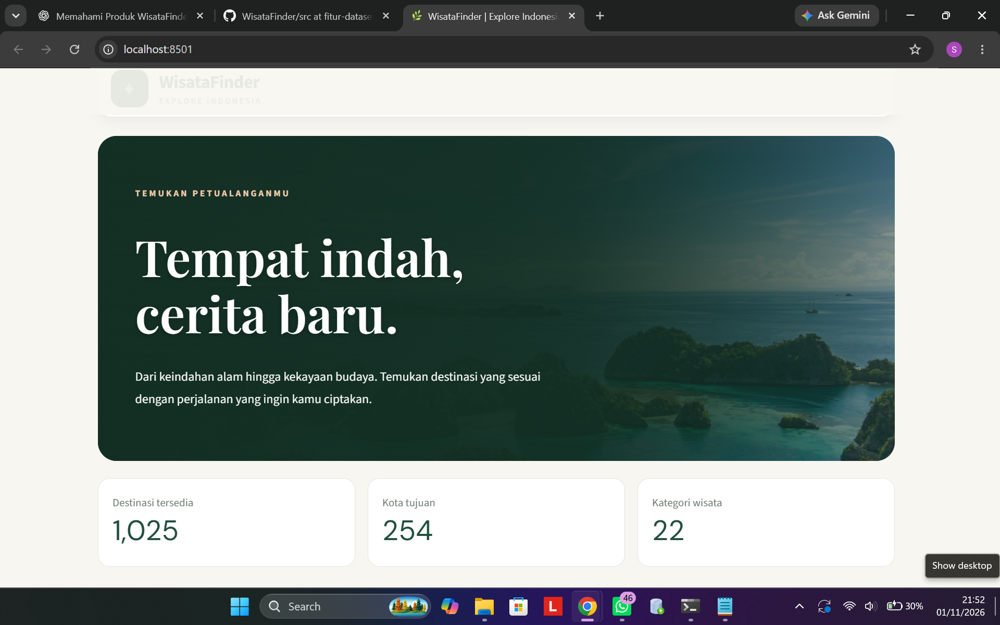
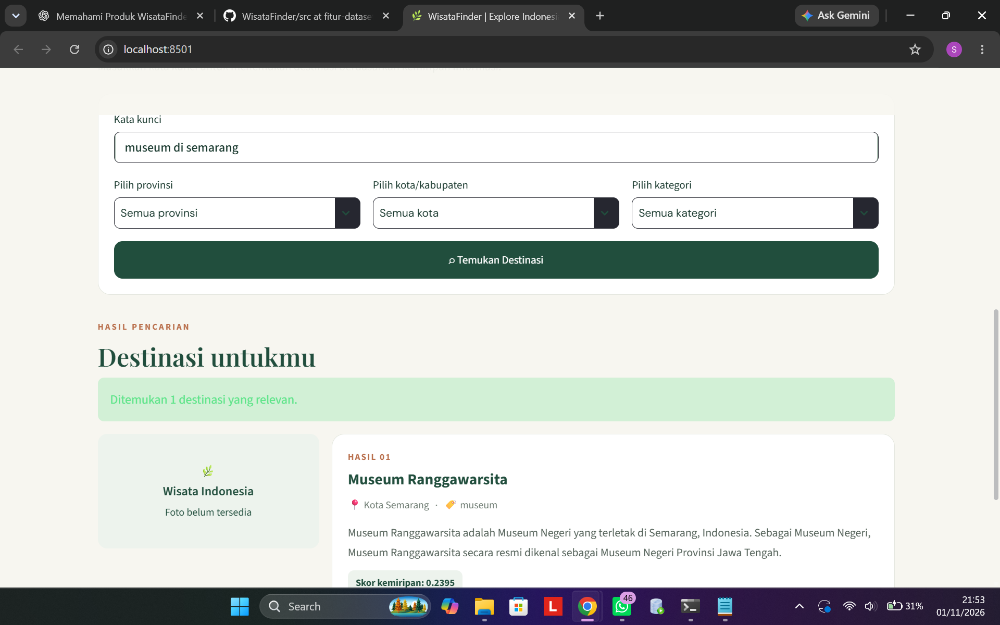
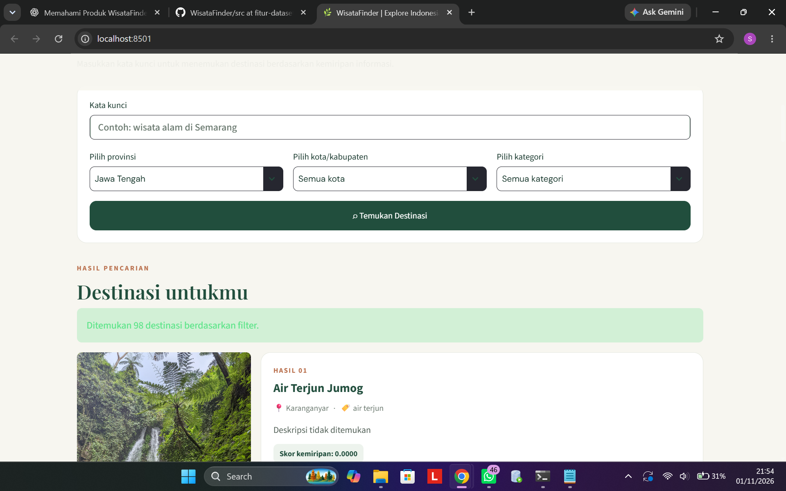
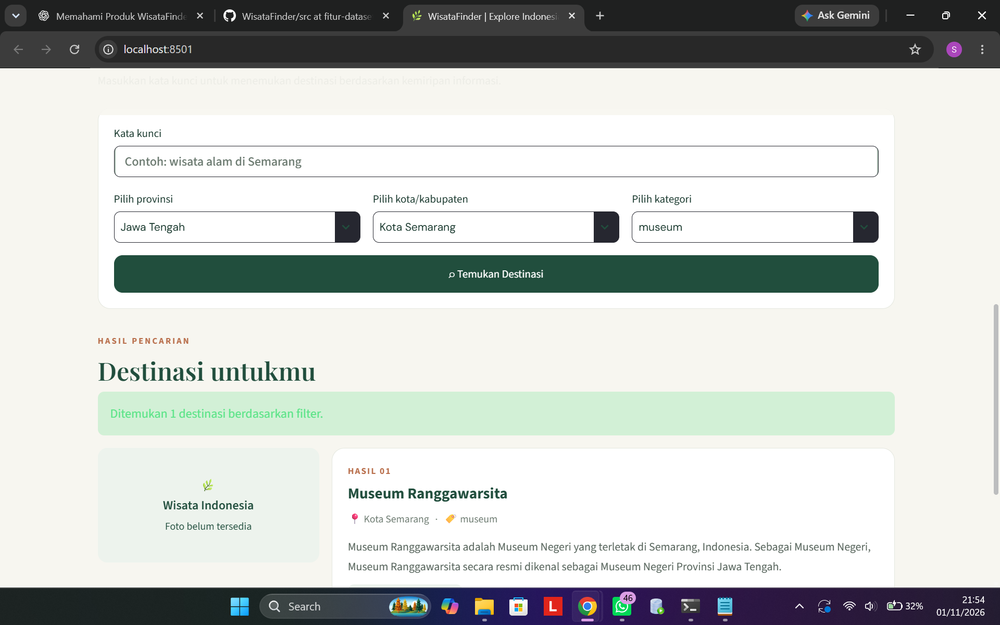
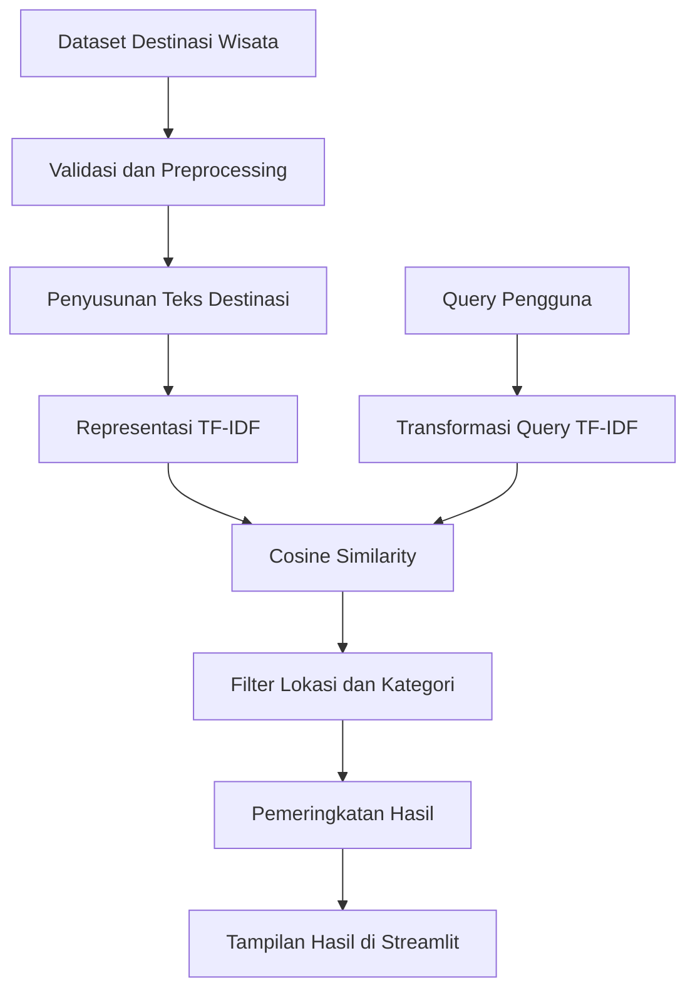

# WisataFinder — Mesin Pencari Destinasi Wisata

**Sistem Temu Kembali Informasi (STKI) menggunakan TF-IDF dan Cosine Similarity**

WisataFinder adalah aplikasi pencarian destinasi wisata di Indonesia yang dikembangkan sebagai proyek akademik mata kuliah Sistem Temu Kembali Informasi (STKI). Aplikasi ini membantu pengguna menemukan destinasi wisata berdasarkan kebutuhan pencarian melalui kata kunci, filter lokasi, dan kategori.

Sistem menerapkan metode **TF-IDF (Term Frequency–Inverse Document Frequency)** untuk merepresentasikan teks destinasi dan **Cosine Similarity** untuk menghitung tingkat kemiripan antara query pengguna dan informasi destinasi. Hasil pencarian kemudian ditampilkan berdasarkan skor kemiripan, dengan penyesuaian tertentu seperti pengurutan harga untuk query yang secara eksplisit meminta wisata murah.


## Pengembangan Dataset dan Versi Aplikasi

WisataFinder dikembangkan melalui dua tahap utama:

| Versi | Dataset | File Aplikasi | Branch |
|---|---:|---|---|
| Versi awal | 437 destinasi | `app.py` | `main` |
| Versi nasional | 1.021 destinasi dari 37 provinsi | `app_nasional_v7.py` | `fitur-dataset-indonesia` |

Kedua versi menggunakan pendekatan Sistem Temu Kembali Informasi (STKI) dengan TF-IDF dan Cosine Similarity. Dataset awal tetap dipertahankan untuk menunjukkan riwayat pengembangan dan sebagai pembanding. Kedua dataset tidak digabungkan.

### Pengembangan Dataset Nasional

Pengembangan versi nasional menggunakan dataset Indonesia Tourism yang diperoleh dari [Kaggle](https://www.kaggle.com/datasets/sagitasantia/indonesia-tourism).

Dataset nasional terdiri dari 1.021 destinasi dengan label wilayah dari 37 provinsi setelah proses pengolahan.

**Catatan ketersediaan dataset:** Dataset mentah belum disertakan dalam repository publik karena ketentuan redistribusinya masih perlu dikonfirmasi. Dataset hasil preprocessing sebanyak 1.021 destinasi tersedia pada `data/processed/destinations_nasional.csv`. Petunjuk sumber dan persiapan dataset dapat dilihat pada `data/README.md`.
### Pengembangan Algoritma

Eksperimen dilakukan melalui versi algoritma V2 sampai V7. Pengembangan mencakup peningkatan pencarian berdasarkan kategori, nama destinasi, kota, dan provinsi.

Hasil evaluasi V7:

- Rata-rata Precision@10 sebesar 70% pada delapan query pengujian.
- Sebanyak 56 dari 56 hasil yang ditemukan dinilai relevan berdasarkan penilaian manual pada sampel pengujian.
- Pengujian penyaringan metadata terhadap 37 provinsi menghasilkan 289 dari 289 hasil yang sesuai dengan metadata provinsi yang diminta.

Hasil tersebut merupakan evaluasi pada skenario pengujian yang digunakan, bukan klaim bahwa seluruh hasil pencarian atau seluruh lokasi destinasi sudah akurat.

### Pengujian Fungsional Aplikasi

Aplikasi nasional telah melalui sembilan skenario pengujian fungsional manual, meliputi:

- Pencarian museum di Semarang dan Bandung.
- Pencarian pantai di Bali.
- Validasi lokasi yang tidak dikenal, seperti Atlantis.
- Pengujian kombinasi filter provinsi, kota/kabupaten, dan kategori.
- Pengujian filter provinsi saja dan kota/kabupaten saja.
- Pengujian ketidaksesuaian antara provinsi dan kota.

Seluruh skenario tersebut memberikan hasil sesuai dengan perilaku yang diharapkan.

### Dokumentasi Penelitian

Dokumentasi proyek tersedia pada:

- [Dokumentasi Dataset](docs/DATASET.md)
- [Metodologi Algoritma](docs/METODOLOGI.md)
- [Hasil Evaluasi](docs/EVALUASI.md)
- [Riwayat Pengembangan](docs/PENGEMBANGAN.md)

### Status Pengembangan

Versi nasional tersedia pada branch [`fitur-dataset-indonesia`](https://github.com/siskamuthoharoh/WisataFinder/tree/fitur-dataset-indonesia). Versi awal tetap dipertahankan pada branch `main`.

Pengembangan berikutnya difokuskan pada peningkatan pengalaman pencarian, pengujian otomatis, dokumentasi produk, dan pengembangan WisataBot.
## Daftar Isi

1. [Latar Belakang](#1-latar-belakang)
2. [Tujuan Proyek](#2-tujuan-proyek)
3. [Fitur Aplikasi](#3-fitur-aplikasi)
4. [Tampilan Aplikasi](#4-tampilan-aplikasi)
5. [Dataset](#5-dataset)
6. [Metode dan Alur Sistem](#6-metode-dan-alur-sistem)
7. [Teknologi yang Digunakan](#7-teknologi-yang-digunakan)
8. [Struktur Repositori](#8-struktur-repositori)
9. [Instalasi dan Menjalankan Aplikasi](#9-instalasi-dan-menjalankan-aplikasi)
10. [Contoh Penggunaan](#10-contoh-penggunaan)
11. [Pengujian dan Evaluasi](#11-pengujian-dan-evaluasi)
12. [Keterbatasan Sistem](#12-keterbatasan-sistem)
13. [Pengembangan Selanjutnya](#13-pengembangan-selanjutnya)
14. [Pengembang](#14-pengembang)

---

## 1. Latar Belakang

Informasi destinasi wisata tersedia dalam berbagai bentuk, seperti nama tempat, deskripsi, kategori, lokasi, harga tiket, dan rating. Pengguna sering kali memiliki kebutuhan pencarian yang spesifik, misalnya mencari wisata alam di Semarang atau tempat wisata murah untuk liburan.

Pencarian yang hanya mengandalkan kecocokan nama tempat belum tentu dapat menemukan destinasi yang sesuai dengan kebutuhan tersebut. Oleh karena itu, diperlukan sistem yang dapat membandingkan kata kunci pengguna dengan informasi tekstual destinasi.

WisataFinder dikembangkan untuk menerapkan konsep temu kembali informasi dalam proses pencarian destinasi wisata. Sistem memanfaatkan representasi teks dan perhitungan kemiripan untuk membantu menyusun hasil pencarian yang relevan dengan query pengguna.

## 2. Tujuan Proyek

Proyek ini memiliki tujuan sebagai berikut:

- Menerapkan konsep Sistem Temu Kembali Informasi pada domain pariwisata.
- Menyiapkan dataset destinasi wisata melalui proses validasi dan preprocessing.
- Menerapkan TF-IDF untuk membentuk representasi numerik dari teks destinasi.
- Menerapkan Cosine Similarity untuk mengukur kemiripan query dengan dokumen destinasi.
- Menyediakan antarmuka pencarian berbasis web menggunakan Streamlit.
- Menyediakan filter lokasi dan kategori untuk membantu mempersempit hasil pencarian.
- Menguji hasil pencarian menggunakan beberapa query dan penilaian relevansi.
- Mendokumentasikan proses pengembangan agar proyek dapat dipahami dan dijalankan kembali.


## 3. Fitur Aplikasi

### 3.1. Pencarian berdasarkan kata kunci

Pengguna dapat memasukkan kata kunci sesuai kebutuhan, misalnya `wisata alam di Semarang`. Sistem membandingkan query dengan informasi tekstual destinasi yang telah disiapkan.

### 3.2. Pemeringkatan hasil pencarian

Destinasi diberi skor kemiripan berdasarkan Cosine Similarity. Skor tersebut digunakan untuk membantu menentukan urutan hasil pencarian.

Skor yang lebih tinggi menunjukkan kemiripan representasi teks yang lebih besar, tetapi tidak selalu berarti bahwa destinasi tersebut paling sesuai dengan seluruh kebutuhan pengguna.

### 3.3. Filter lokasi dan kategori

Pengguna dapat mempersempit hasil berdasarkan pilihan lokasi dan kategori yang tersedia pada aplikasi. Filter ini membantu mengurangi hasil yang tidak sesuai dengan cakupan pencarian.

### 3.4. Pengurutan berdasarkan harga

Untuk query yang secara eksplisit menunjukkan kebutuhan wisata murah, sistem memiliki penyesuaian pengurutan berdasarkan harga. Fitur ini membantu pengguna yang memprioritaskan biaya.

Pengurutan harga merupakan penyesuaian berdasarkan kebutuhan query, bukan pengganti perhitungan kemiripan teks.

### 3.5. Tampilan hasil berbasis web

Hasil pencarian ditampilkan melalui antarmuka Streamlit agar pengguna dapat mencoba sistem tanpa harus menjalankan perhitungan secara manual.

## 4. Tampilan Aplikasi

### 4.1. Halaman Utama



### 4.2. Pencarian Berdasarkan Kata Kunci



### 4.3. Pencarian Menggunakan Filter Tanpa Kata Kunci



### 4.4. Kombinasi Filter




## 5. Dataset

WisataFinder menggunakan dataset destinasi wisata Indonesia yang tersedia dalam berkas berikut.

| Informasi | Keterangan |
|---|---|
| Nama dataset | Indonesia Tourism Destination |
| Dataset mentah | `data/raw/tourism_with_id.csv` |
| Dataset hasil preprocessing | `data/processed/destinations_clean.csv` |
| Jumlah data awal yang tercatat | 437 destinasi |
| Format | CSV |

Dataset memuat informasi seperti ID destinasi, nama tempat, deskripsi, kategori, kota, harga, rating, durasi kunjungan, dan informasi koordinat. Dataset hasil pengolahan juga memuat teks pencarian serta label lokasi tambahan.

### Peran data dalam sistem

- **Nama dan deskripsi:** menyediakan informasi tekstual untuk pencarian.
- **Kategori dan lokasi:** mendukung penyaringan hasil.
- **Harga:** mendukung kebutuhan pencarian yang memprioritaskan biaya.
- **Rating dan atribut lain:** menyediakan informasi tambahan sesuai tampilan aplikasi.

Jumlah data awal tidak selalu sama dengan jumlah data akhir apabila preprocessing menghapus baris atau kolom tertentu. Jumlah dan kondisi dataset akhir perlu diperiksa dari berkas yang digunakan aplikasi.

### Sumber dan atribusi

Sumber asli dataset, atribusi pembuat, dan ketentuan lisensinya perlu dicatat berdasarkan halaman sumber dataset yang sebenarnya. Jangan menganggap dataset bebas digunakan kembali sebelum ketentuan lisensinya diverifikasi.

## 6. Metode dan Alur Sistem

WisataFinder menggunakan pendekatan temu kembali informasi berbasis teks dengan TF-IDF dan Cosine Similarity.

### 6.1. Validasi dan preprocessing data

Dataset diperiksa dan disiapkan sebelum digunakan dalam pencarian. Tahap ini mencakup pemeriksaan struktur kolom, penanganan kolom yang tidak diperlukan, pemeriksaan data, serta penyusunan teks yang digunakan sebagai representasi pencarian.

Tujuan preprocessing adalah menyiapkan informasi destinasi dalam format yang konsisten dan dapat diproses oleh sistem. Rincian operasi preprocessing mengikuti implementasi pada `src/preprocess_data.py`.

### 6.2. Pembobotan TF-IDF

TF-IDF mengubah teks menjadi representasi numerik berdasarkan pentingnya kata dalam suatu dokumen dibandingkan dengan kumpulan dokumen.

Secara konseptual:

- **TF (Term Frequency)** menggambarkan frekuensi kemunculan suatu kata dalam dokumen.
- **IDF (Inverse Document Frequency)** memberikan bobot berdasarkan seberapa umum atau jarang kata tersebut muncul dalam kumpulan dokumen.
- **TF-IDF** menggabungkan kedua informasi tersebut untuk membentuk bobot kata.

Kata yang muncul pada banyak dokumen dapat memiliki daya pembeda yang lebih kecil dibandingkan kata yang lebih spesifik. Dengan demikian, dokumen destinasi dapat direpresentasikan sebagai vektor numerik.

### 6.3. Cosine Similarity

Setelah query dan dokumen destinasi direpresentasikan dalam ruang fitur yang sama, sistem menghitung kemiripan vektor menggunakan Cosine Similarity.

Secara matematis, kemiripan antara vektor query \(q\) dan vektor dokumen \(d\) dinyatakan sebagai:

Cosine Similarity(q, d) = (q · d) / (||q|| × ||d||)
Keterangan:
- q = vektor query pengguna.
- d = vektor dokumen destinasi.
- q · d = hasil perkalian titik kedua vektor.
- ||q|| dan ||d|| = panjang atau norma masing-masing vektor.

Nilai ini membandingkan arah kedua vektor. Dalam representasi TF-IDF yang umum digunakan, skor yang lebih tinggi menunjukkan kemiripan pola kata yang lebih besar.

### 6.4. Pemeringkatan hasil

Alur pencarian secara umum adalah:

1. Pengguna memasukkan query.
2. Sistem menyiapkan query sesuai representasi teks yang digunakan.
3. Query diubah menjadi vektor TF-IDF.
4. Sistem menghitung Cosine Similarity terhadap representasi dokumen destinasi.
5. Sistem menerapkan filter lokasi dan kategori sesuai pilihan pengguna serta aturan lokasi yang digunakan aplikasi.
6. Hasil diurutkan berdasarkan skor kemiripan atau penyesuaian harga untuk query yang memprioritaskan wisata murah.
7. Hasil ditampilkan pada antarmuka Streamlit.

Urutan tersebut menjelaskan alur konseptual sistem. Detail implementasi dan kondisi khusus mengikuti kode aktual aplikasi.

### 6.5. Diagram alur sistem



Diagram ini menggambarkan hubungan utama antara data, query, pemeringkatan, dan tampilan hasil.

## 7. Teknologi yang Digunakan

| Teknologi | Peran |
|---|---|
| Python | Bahasa pemrograman utama |
| Pandas | Pengolahan dan pemeriksaan data |
| Scikit-learn | Representasi TF-IDF dan perhitungan kemiripan |
| Streamlit | Antarmuka aplikasi web |
| Requests | Dukungan permintaan HTTP apabila digunakan oleh aplikasi |
| Git | Pengelolaan versi kode |
| GitHub | Penyimpanan repositori dan dokumentasi proyek |
| Anaconda | Pengelolaan environment Python |

## 8. Struktur Repositori

Struktur repository WisataFinder pada branch `fitur-dataset-indonesia`:

```text
WisataFinder/
├── .gitignore
├── README.md
├── requirements.txt
├── app.py
├── app_nasional_v7.py
│
├── data/
│   ├── README.md
│   ├── raw/
│   │   └── tourism_with_id.csv
│   └── processed/
│       ├── destinations_clean.csv
│       ├── evaluasi_precision_v7.csv
│       ├── evaluasi_provinsi_v7.csv
│       ├── perbandingan_akhir_v2_v7.csv
│       └── ringkasan_audit_final.csv
│
├── docs/
│   ├── DATASET.md
│   ├── METODOLOGI.md
│   ├── EVALUASI.md
│   └── PENGEMBANGAN.md
│
├── notebooks/
│   ├── 01_eksplorasi_data.ipynb
│   ├── 02_eksperimen_stki.ipynb
│   └── pengembangan_dan_evaluasi_algoritma_nasional.ipynb
│
├── reports/
│   ├── evaluasi_query_expansion.csv
│   └── validasi_dataset.txt
│
└── src/
    ├── inspect_columns.py
    ├── preprocess_data.py
    └── validate_data.py
```

### Keterangan Struktur

| Folder/File | Fungsi |
|---|---|
| `app.py` | Aplikasi pencarian versi awal |
| `app_nasional_v7.py` | Aplikasi pengembangan dataset nasional |
| `data/` | Dataset dan laporan hasil pengolahan |
| `notebooks/` | Eksplorasi data dan eksperimen algoritma |
| `src/` | Script pemeriksaan, preprocessing, dan validasi data |
| `docs/` | Dokumentasi penelitian dan pengembangan |
| `reports/` | Laporan hasil penelitian |

**Catatan:** Dataset hasil preprocessing sebanyak 1.021 destinasi tersedia di `data/processed/destinations_nasional.csv`. Dataset mentah belum disertakan karena ketentuan redistribusinya masih perlu dikonfirmasi. Informasi sumber dan petunjuk penyediaan dataset tersedia di `data/README.md`.

## 9. Instalasi dan Menjalankan Aplikasi

### Persyaratan

- Python 3.10.
- Anaconda atau Miniconda.
- Git.
- Dependensi dalam requirements.txt.
- Dataset yang diperlukan aplikasi.

### 9.1. Clone repository

```bash
git clone https://github.com/siskamuthoharoh/WisataFinder.git
cd WisataFinder
```

### 9.2. Membuat environment

```bash
conda create -n wisatafinder python=3.10 -y
conda activate wisatafinder
```

### 9.3. Menginstal dependensi

```bash
python -m pip install -r requirements.txt
```

### 9.4. Menjalankan aplikasi awal

```bash
streamlit run app.py
```

Aplikasi awal menggunakan destinations_clean.csv.

### 9.5. Menjalankan aplikasi nasional

Aplikasi nasional menggunakan dataset `data/processed/destinations_nasional.csv`.

**Persiapan dataset:**

1. Baca petunjuk pada `data/README.md`.
2. Dapatkan dataset dari sumber yang tercantum dalam dokumentasi.
3. Lakukan pengolahan data sesuai prosedur yang tersedia.
4. Pastikan file `destinations_nasional.csv` tersedia pada folder `data/processed/`.

**Menjalankan aplikasi:**

```bash
streamlit run app_nasional_v7.py
```

**Catatan:** Dataset mentah tidak disertakan dalam repository publik karena ketentuan redistribusinya masih perlu dikonfirmasi. Dataset hasil preprocessing sebanyak 1.021 destinasi tersedia di `data/processed/destinations_nasional.csv`. Aplikasi nasional telah melalui sembilan skenario pengujian fungsional manual. Hasil evaluasi algoritma tersedia pada folder `data/processed/` dan dokumentasi `docs/EVALUASI.md`.

Berikut contoh query untuk mencoba perilaku pencarian.

| Query | Tujuan pengujian |
|---|---|
| `wisata alam di Semarang` | Memeriksa pencarian berdasarkan topik dan lokasi. |
| `wisata murah di Semarang` | Memeriksa kebutuhan pencarian dengan prioritas harga. |
| `pantai untuk liburan` | Memeriksa pencarian berdasarkan jenis destinasi. |
| `tempat wisata keluarga` | Memeriksa pencarian berdasarkan kebutuhan pengunjung. |

Contoh di atas adalah query pengujian, bukan klaim bahwa semua hasilnya pasti relevan. Kualitas hasil perlu diperiksa melalui keluaran aplikasi dan penilaian relevansi.

## 10. Contoh Penggunaan

Berikut contoh query untuk mencoba perilaku pencarian pada aplikasi WisataFinder.

| Query | Tujuan Pengujian |
|---|---|
| `wisata alam di Semarang` | Memeriksa pencarian berdasarkan topik dan lokasi. |
| `wisata murah di Semarang` | Memeriksa pencarian dengan prioritas harga. |
| `pantai untuk liburan` | Memeriksa pencarian berdasarkan jenis destinasi. |
| `tempat wisata keluarga` | Memeriksa pencarian berdasarkan kebutuhan pengunjung. |

Selain menggunakan kata kunci, pengguna juga dapat melakukan pencarian dengan memilih filter provinsi, kota/kabupaten, dan kategori tanpa harus memasukkan kata kunci.

Contoh query di atas merupakan skenario pengujian. Relevansi hasil pencarian tetap perlu diperiksa melalui keluaran aplikasi dan penilaian relevansi.

## 11. Pengujian dan Evaluasi

Pengujian dilakukan untuk memeriksa apakah aplikasi berjalan dengan baik dan apakah hasil pencarian sesuai dengan kebutuhan query.

### 11.1. Pengujian fungsional

Pemeriksaan fungsional dapat mencakup:

- Aplikasi dapat dijalankan.
- Query dapat dimasukkan dan diproses.
- Hasil pencarian ditampilkan.
- Filter lokasi dan kategori bekerja sesuai pilihan.
- Pengurutan harga berjalan pada query yang memprioritaskan harga.
- Data lokasi yang belum terverifikasi ditangani sesuai aturan aplikasi.

### 11.2. Evaluasi relevansi

Selain fungsi aplikasi, kualitas pemeringkatan perlu diperiksa menggunakan query uji dan label relevansi. Penilaian relevansi sebaiknya dilakukan berdasarkan kriteria yang konsisten untuk setiap query.

Metrik yang dapat digunakan:

**Precision@5**

Mengukur proporsi dari lima hasil teratas yang dinilai relevan.

Precision@5 = Jumlah hasil relevan pada top-5 / 5

**Recall@5**

Mengukur proporsi seluruh dokumen relevan yang berhasil ditemukan dalam lima hasil teratas, dengan syarat jumlah dokumen relevan untuk query telah diketahui.

Recall@5 = Jumlah hasil relevan pada top-5 / Jumlah seluruh dokumen relevan


Metrik tersebut perlu dihitung dari data penilaian yang benar-benar diperiksa. Berkas kandidat atau audit saja tidak membuktikan bahwa kualitas sistem sudah baik.

### 11.3. Status pengujian

Status implementasi dan evaluasi harus diperbarui berdasarkan hasil pengujian terakhir. Jangan mencantumkan nilai metrik, jumlah tes yang lulus, atau klaim keberhasilan yang belum diperiksa.

## 12. Keterbatasan Sistem

Beberapa keterbatasan yang perlu diperhatikan:

- TF-IDF dan Cosine Similarity terutama mengukur kemiripan representasi kata; keduanya tidak sepenuhnya memahami makna atau konteks bahasa.
- Query dengan sinonim atau istilah yang berbeda dari deskripsi dataset dapat menghasilkan pemeringkatan yang kurang sesuai.
- Kualitas hasil dipengaruhi kelengkapan, konsistensi, dan ketepatan informasi destinasi.
- Informasi lokasi pada dataset sumber perlu diverifikasi karena label kota tidak selalu menjamin ketepatan administratif lokasi destinasi.
- Skor kemiripan bukan probabilitas bahwa destinasi pasti relevan.
- Foto destinasi hanya dapat ditampilkan dengan baik jika sumber gambar tersedia dan dapat diakses.

Keterbatasan tersebut menjadi pertimbangan saat menafsirkan hasil pencarian dan merencanakan perbaikan sistem.

## 13. Pengembangan Selanjutnya

Pengembangan selanjutnya dapat difokuskan pada:

- Memperbaiki konsistensi dan verifikasi data lokasi.
- Memeriksa relevansi hasil dengan query yang mewakili kebutuhan pengguna.
- Menambahkan pengujian otomatis untuk fungsi penting.
- Memperjelas sumber, atribusi, dan lisensi dataset.
- Memperbaiki penyajian informasi dan ketersediaan gambar destinasi.
- Mendokumentasikan hasil evaluasi berdasarkan data yang telah diverifikasi.

Prioritas pengembangan ditentukan berdasarkan hasil pengujian aktual, bukan hanya berdasarkan penambahan fitur.

## 14. Pengembang

Proyek akademik mata kuliah **Sistem Temu Kembali Informasi (STKI)**.

Repositori: [WisataFinder di GitHub](https://github.com/siskamuthoharoh/WisataFinder)
