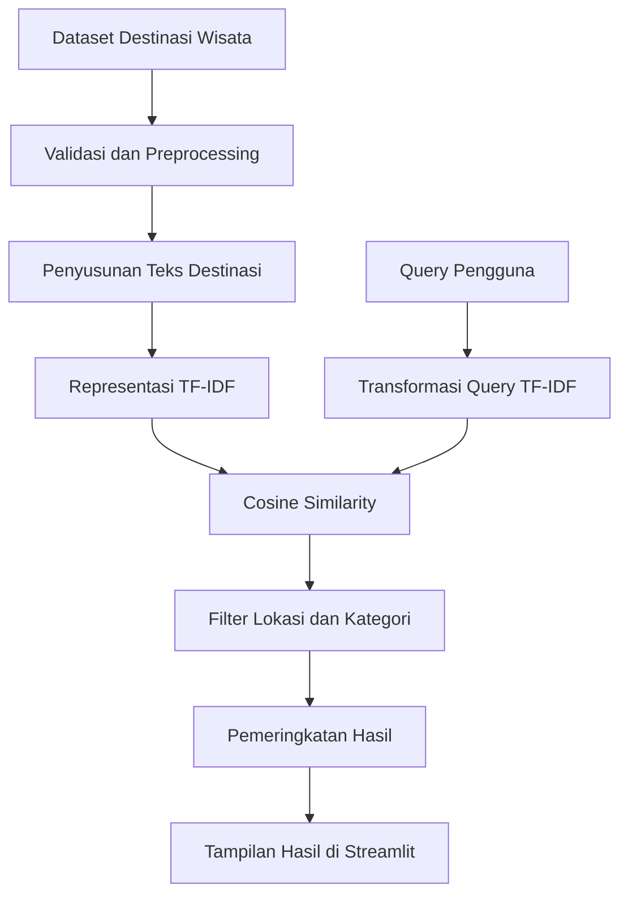

# WisataFinder — Mesin Pencari Destinasi Wisata

**Sistem Temu Kembali Informasi (STKI) menggunakan TF-IDF dan Cosine Similarity**

WisataFinder adalah aplikasi pencarian destinasi wisata di Indonesia yang dikembangkan sebagai proyek akademik mata kuliah Sistem Temu Kembali Informasi (STKI). Aplikasi ini membantu pengguna menemukan destinasi wisata berdasarkan kebutuhan pencarian melalui kata kunci, filter lokasi, dan kategori.

Sistem menerapkan metode **TF-IDF (Term Frequency–Inverse Document Frequency)** untuk merepresentasikan teks destinasi dan **Cosine Similarity** untuk menghitung tingkat kemiripan antara query pengguna dan informasi destinasi. Hasil pencarian kemudian ditampilkan berdasarkan skor kemiripan, dengan penyesuaian tertentu seperti pengurutan harga untuk query yang secara eksplisit meminta wisata murah.

---

## Daftar Isi

1. [Latar Belakang](#1-latar-belakang)
2. [Tujuan Proyek](#2-tujuan-proyek)
3. [Fitur Aplikasi](#3-fitur-aplikasi)
4. [Dataset](#4-dataset)
5. [Metode dan Alur Sistem](#5-metode-dan-alur-sistem)
6. [Teknologi yang Digunakan](#6-teknologi-yang-digunakan)
7. [Struktur Repositori](#7-struktur-repositori)
8. [Instalasi dan Menjalankan Aplikasi](#8-instalasi-dan-menjalankan-aplikasi)
9. [Contoh Penggunaan](#9-contoh-penggunaan)
10. [Pengujian dan Evaluasi](#10-pengujian-dan-evaluasi)
11. [Keterbatasan Sistem](#11-keterbatasan-sistem)
12. [Pengembangan Selanjutnya](#12-pengembangan-selanjutnya)
13. [Pengembang](#13-pengembang)

---

## 1. Latar Belakang

Informasi destinasi wisata tersedia dalam berbagai bentuk, seperti nama tempat, deskripsi, kategori, lokasi, harga tiket, dan rating. Pengguna sering kali memiliki kebutuhan pencarian yang spesifik, misalnya mencari wisata alam di Semarang atau tempat wisata murah untuk liburan.

Pencarian yang hanya mengandalkan kecocokan nama tempat belum tentu dapat menemukan destinasi yang sesuai dengan kebutuhan tersebut. Oleh karena itu, diperlukan sistem yang dapat membandingkan kata kunci pengguna dengan informasi tekstual destinasi.

WisataFinder dikembangkan untuk menerapkan konsep temu kembali informasi dalam proses pencarian destinasi wisata. Sistem memanfaatkan representasi teks dan perhitungan kemiripan untuk membantu menyusun hasil pencarian yang relevan dengan query pengguna.

## 2. Tujuan Proyek

Proyek ini memiliki tujuan sebagai berikut:

- Menerapkan konsep Sistem Temu Kembali Informasi pada domain pariwisata.
- Menyiapkan dataset destinasi wisata melalui proses validasi dan preprocessing.
- Menerapkan TF-IDF untuk membentuk representasi numerik dari teks destinasi.
- Menerapkan Cosine Similarity untuk mengukur kemiripan query dengan dokumen destinasi.
- Menyediakan antarmuka pencarian berbasis web menggunakan Streamlit.
- Menyediakan filter lokasi dan kategori untuk membantu mempersempit hasil pencarian.
- Menguji hasil pencarian menggunakan beberapa query dan penilaian relevansi.
- Mendokumentasikan proses pengembangan agar proyek dapat dipahami dan dijalankan kembali.

## 3. Fitur Aplikasi

### 3.1. Pencarian berdasarkan kata kunci

Pengguna dapat memasukkan kata kunci sesuai kebutuhan, misalnya `wisata alam di Semarang`. Sistem membandingkan query dengan informasi tekstual destinasi yang telah disiapkan.

### 3.2. Pemeringkatan hasil pencarian

Destinasi diberi skor kemiripan berdasarkan Cosine Similarity. Skor tersebut digunakan untuk membantu menentukan urutan hasil pencarian.

Skor yang lebih tinggi menunjukkan kemiripan representasi teks yang lebih besar, tetapi tidak selalu berarti bahwa destinasi tersebut paling sesuai dengan seluruh kebutuhan pengguna.

### 3.3. Filter lokasi dan kategori

Pengguna dapat mempersempit hasil berdasarkan pilihan lokasi dan kategori yang tersedia pada aplikasi. Filter ini membantu mengurangi hasil yang tidak sesuai dengan cakupan pencarian.

### 3.4. Pengurutan berdasarkan harga

Untuk query yang secara eksplisit menunjukkan kebutuhan wisata murah, sistem memiliki penyesuaian pengurutan berdasarkan harga. Fitur ini membantu pengguna yang memprioritaskan biaya.

Pengurutan harga merupakan penyesuaian berdasarkan kebutuhan query, bukan pengganti perhitungan kemiripan teks.

### 3.5. Tampilan hasil berbasis web

Hasil pencarian ditampilkan melalui antarmuka Streamlit agar pengguna dapat mencoba sistem tanpa harus menjalankan perhitungan secara manual.

## 4. Dataset

WisataFinder menggunakan dataset destinasi wisata Indonesia yang tersedia dalam berkas berikut.

| Informasi | Keterangan |
|---|---|
| Nama dataset | Indonesia Tourism Destination |
| Dataset mentah | `data/raw/tourism_with_id.csv` |
| Dataset hasil preprocessing | `data/processed/destinations_clean.csv` |
| Jumlah data awal yang tercatat | 437 destinasi |
| Format | CSV |

Dataset memuat informasi seperti ID destinasi, nama tempat, deskripsi, kategori, kota, harga, rating, durasi kunjungan, dan informasi koordinat. Dataset hasil pengolahan juga memuat teks pencarian serta label lokasi tambahan.

### Peran data dalam sistem

- **Nama dan deskripsi:** menyediakan informasi tekstual untuk pencarian.
- **Kategori dan lokasi:** mendukung penyaringan hasil.
- **Harga:** mendukung kebutuhan pencarian yang memprioritaskan biaya.
- **Rating dan atribut lain:** menyediakan informasi tambahan sesuai tampilan aplikasi.

Jumlah data awal tidak selalu sama dengan jumlah data akhir apabila preprocessing menghapus baris atau kolom tertentu. Jumlah dan kondisi dataset akhir perlu diperiksa dari berkas yang digunakan aplikasi.

### Sumber dan atribusi

Sumber asli dataset, atribusi pembuat, dan ketentuan lisensinya perlu dicatat berdasarkan halaman sumber dataset yang sebenarnya. Jangan menganggap dataset bebas digunakan kembali sebelum ketentuan lisensinya diverifikasi.

## 5. Metode dan Alur Sistem

WisataFinder menggunakan pendekatan temu kembali informasi berbasis teks dengan TF-IDF dan Cosine Similarity.

### 5.1. Validasi dan preprocessing data

Dataset diperiksa dan disiapkan sebelum digunakan dalam pencarian. Tahap ini mencakup pemeriksaan struktur kolom, penanganan kolom yang tidak diperlukan, pemeriksaan data, serta penyusunan teks yang digunakan sebagai representasi pencarian.

Tujuan preprocessing adalah menyiapkan informasi destinasi dalam format yang konsisten dan dapat diproses oleh sistem. Rincian operasi preprocessing mengikuti implementasi pada `src/preprocess_data.py`.

### 5.2. Pembobotan TF-IDF

TF-IDF mengubah teks menjadi representasi numerik berdasarkan pentingnya kata dalam suatu dokumen dibandingkan dengan kumpulan dokumen.

Secara konseptual:

- **TF (Term Frequency)** menggambarkan frekuensi kemunculan suatu kata dalam dokumen.
- **IDF (Inverse Document Frequency)** memberikan bobot berdasarkan seberapa umum atau jarang kata tersebut muncul dalam kumpulan dokumen.
- **TF-IDF** menggabungkan kedua informasi tersebut untuk membentuk bobot kata.

Kata yang muncul pada banyak dokumen dapat memiliki daya pembeda yang lebih kecil dibandingkan kata yang lebih spesifik. Dengan demikian, dokumen destinasi dapat direpresentasikan sebagai vektor numerik.

### 5.3. Cosine Similarity

Setelah query dan dokumen destinasi direpresentasikan dalam ruang fitur yang sama, sistem menghitung kemiripan vektor menggunakan Cosine Similarity.

Secara matematis, kemiripan antara vektor query \(q\) dan vektor dokumen \(d\) dinyatakan sebagai:

Cosine Similarity(q, d) = (q · d) / (||q|| × ||d||)
Keterangan:
- q = vektor query pengguna.
- d = vektor dokumen destinasi.
- q · d = hasil perkalian titik kedua vektor.
- ||q|| dan ||d|| = panjang atau norma masing-masing vektor.

Nilai ini membandingkan arah kedua vektor. Dalam representasi TF-IDF yang umum digunakan, skor yang lebih tinggi menunjukkan kemiripan pola kata yang lebih besar.

### 5.4. Pemeringkatan hasil

Alur pencarian secara umum adalah:

1. Pengguna memasukkan query.
2. Sistem menyiapkan query sesuai representasi teks yang digunakan.
3. Query diubah menjadi vektor TF-IDF.
4. Sistem menghitung Cosine Similarity terhadap representasi dokumen destinasi.
5. Sistem menerapkan filter lokasi dan kategori sesuai pilihan pengguna serta aturan lokasi yang digunakan aplikasi.
6. Hasil diurutkan berdasarkan skor kemiripan atau penyesuaian harga untuk query yang memprioritaskan wisata murah.
7. Hasil ditampilkan pada antarmuka Streamlit.

Urutan tersebut menjelaskan alur konseptual sistem. Detail implementasi dan kondisi khusus mengikuti kode aktual aplikasi.

### 5.5. Diagram alur sistem



Diagram ini menggambarkan hubungan utama antara data, query, pemeringkatan, dan tampilan hasil.

## 6. Teknologi yang Digunakan

| Teknologi | Peran |
|---|---|
| Python | Bahasa pemrograman utama |
| Pandas | Pengolahan dan pemeriksaan data |
| Scikit-learn | Representasi TF-IDF dan perhitungan kemiripan |
| Streamlit | Antarmuka aplikasi web |
| Requests | Dukungan permintaan HTTP apabila digunakan oleh aplikasi |
| Git | Pengelolaan versi kode |
| GitHub | Penyimpanan repositori dan dokumentasi proyek |
| Anaconda | Pengelolaan environment Python |

## 7. Struktur Repositori

```text
WisataFinder/
├── app.py
├── requirements.txt
├── README.md
├── .gitignore
├── .streamlit/
├── data/
│   ├── raw/
│   │   └── tourism_with_id.csv
│   └── processed/
│       └── destinations_clean.csv
├── docs/
├── notebooks/
├── reports/
│   └── figures/
├── src/
│   └── preprocess_data.py
└── tests/
```

Fungsi direktori dan berkas utama:

| Berkas atau direktori | Fungsi |
|---|---|
| `app.py` | Implementasi antarmuka dan logika pencarian aplikasi. |
| `requirements.txt` | Daftar dependensi Python yang diperlukan. |
| `README.md` | Dokumentasi utama proyek. |
| `.gitignore` | Mengatur berkas lokal yang tidak perlu dimasukkan ke Git. |
| `.streamlit/` | Konfigurasi Streamlit apabila digunakan. |
| `data/raw/` | Menyimpan dataset sumber. |
| `data/processed/` | Menyimpan dataset hasil pengolahan. |
| `src/` | Kode pendukung, termasuk preprocessing. |
| `docs/` | Dokumentasi tambahan, misalnya sumber dan keterangan dataset. |
| `notebooks/` | Notebook eksplorasi atau eksperimen jika diperlukan. |
| `reports/figures/` | Gambar atau visualisasi pendukung jika tersedia. |
| `tests/` | Pengujian otomatis jika sudah diimplementasikan. |

Struktur di atas menunjukkan susunan yang dituju. Isi aktual setiap direktori perlu diperiksa sebelum dianggap lengkap.

## 8. Instalasi dan Menjalankan Aplikasi

### Persyaratan

- Windows dengan Anaconda atau Miniconda.
- Git jika ingin mengambil repositori menggunakan Git.
- Python dengan versi yang kompatibel dengan dependensi proyek.
- Dataset yang diperlukan tersedia pada lokasi berkas yang diharapkan aplikasi.

### 8.1. Mengambil repositori

Jika repositori belum tersedia di komputer:

```bash
git clone https://github.com/siskamuthoharoh/WisataFinder.git
cd WisataFinder
```

Jika repositori sudah tersedia secara lokal, masuk ke folder proyek yang ada.

### 8.2. Mengaktifkan environment

Untuk environment yang digunakan selama pengembangan:

```bash
conda activate ds_siska
```

Jika environment tersebut belum tersedia di komputer lain, buat environment baru dengan versi Python yang kompatibel dengan dependensi proyek.

### 8.3. Menginstal dependensi

Dari direktori utama proyek, jalankan:

```bash
python -m pip install -r requirements.txt
```

### 8.4. Menyiapkan dataset

Pastikan dataset mentah tersedia di `data/raw/tourism_with_id.csv`.

Untuk menjalankan preprocessing kembali:

```bash
python -m src.preprocess_data
```

Perintah tersebut menghasilkan dataset olahan pada `data/processed/destinations_clean.csv` sesuai implementasi preprocessing.

Jika dataset olahan yang dibutuhkan sudah tersedia dan sesuai, periksa terlebih dahulu apakah preprocessing ulang memang diperlukan.

### 8.5. Menjalankan aplikasi

Jalankan:

```bash
streamlit run app.py
```

Terminal akan menampilkan alamat lokal Streamlit. Buka alamat tersebut melalui browser untuk menggunakan aplikasi.

Jika terjadi kesalahan, periksa pesan pada terminal, keberadaan dataset, environment aktif, dan dependensi yang terpasang.

## 9. Contoh Penggunaan

Berikut contoh query untuk mencoba perilaku pencarian.

| Query | Tujuan pengujian |
|---|---|
| `wisata alam di Semarang` | Memeriksa pencarian berdasarkan topik dan lokasi. |
| `wisata murah di Semarang` | Memeriksa kebutuhan pencarian dengan prioritas harga. |
| `pantai untuk liburan` | Memeriksa pencarian berdasarkan jenis destinasi. |
| `tempat wisata keluarga` | Memeriksa pencarian berdasarkan kebutuhan pengunjung. |

Contoh di atas adalah query pengujian, bukan klaim bahwa semua hasilnya pasti relevan. Kualitas hasil perlu diperiksa melalui keluaran aplikasi dan penilaian relevansi.

## 10. Pengujian dan Evaluasi

Pengujian dilakukan untuk memeriksa apakah aplikasi berjalan dengan baik dan apakah hasil pencarian sesuai dengan kebutuhan query.

### 10.1. Pengujian fungsional

Pemeriksaan fungsional dapat mencakup:

- Aplikasi dapat dijalankan.
- Query dapat dimasukkan dan diproses.
- Hasil pencarian ditampilkan.
- Filter lokasi dan kategori bekerja sesuai pilihan.
- Pengurutan harga berjalan pada query yang memprioritaskan harga.
- Data lokasi yang belum terverifikasi ditangani sesuai aturan aplikasi.

### 10.2. Evaluasi relevansi

Selain fungsi aplikasi, kualitas pemeringkatan perlu diperiksa menggunakan query uji dan label relevansi. Penilaian relevansi sebaiknya dilakukan berdasarkan kriteria yang konsisten untuk setiap query.

Metrik yang dapat digunakan:

**Precision@5**

Mengukur proporsi dari lima hasil teratas yang dinilai relevan.

Precision@5 = Jumlah hasil relevan pada top-5 / 5

**Recall@5**

Mengukur proporsi seluruh dokumen relevan yang berhasil ditemukan dalam lima hasil teratas, dengan syarat jumlah dokumen relevan untuk query telah diketahui.

Recall@5 = Jumlah hasil relevan pada top-5 / Jumlah seluruh dokumen relevan


Metrik tersebut perlu dihitung dari data penilaian yang benar-benar diperiksa. Berkas kandidat atau audit saja tidak membuktikan bahwa kualitas sistem sudah baik.

### 10.3. Status pengujian

Status implementasi dan evaluasi harus diperbarui berdasarkan hasil pengujian terakhir. Jangan mencantumkan nilai metrik, jumlah tes yang lulus, atau klaim keberhasilan yang belum diperiksa.

## 11. Keterbatasan Sistem

Beberapa keterbatasan yang perlu diperhatikan:

- TF-IDF dan Cosine Similarity terutama mengukur kemiripan representasi kata; keduanya tidak sepenuhnya memahami makna atau konteks bahasa.
- Query dengan sinonim atau istilah yang berbeda dari deskripsi dataset dapat menghasilkan pemeringkatan yang kurang sesuai.
- Kualitas hasil dipengaruhi kelengkapan, konsistensi, dan ketepatan informasi destinasi.
- Informasi lokasi pada dataset sumber perlu diverifikasi karena label kota tidak selalu menjamin ketepatan administratif lokasi destinasi.
- Skor kemiripan bukan probabilitas bahwa destinasi pasti relevan.
- Foto destinasi hanya dapat ditampilkan dengan baik jika sumber gambar tersedia dan dapat diakses.

Keterbatasan tersebut menjadi pertimbangan saat menafsirkan hasil pencarian dan merencanakan perbaikan sistem.

## 12. Pengembangan Selanjutnya

Pengembangan selanjutnya dapat difokuskan pada:

- Memperbaiki konsistensi dan verifikasi data lokasi.
- Memeriksa relevansi hasil dengan query yang mewakili kebutuhan pengguna.
- Menambahkan pengujian otomatis untuk fungsi penting.
- Memperjelas sumber, atribusi, dan lisensi dataset.
- Memperbaiki penyajian informasi dan ketersediaan gambar destinasi.
- Mendokumentasikan hasil evaluasi berdasarkan data yang telah diverifikasi.

Prioritas pengembangan ditentukan berdasarkan hasil pengujian aktual, bukan hanya berdasarkan penambahan fitur.

## 13. Pengembang

Proyek akademik mata kuliah **Sistem Temu Kembali Informasi (STKI)**.

Repositori: [WisataFinder di GitHub](https://github.com/siskamuthoharoh/WisataFinder)
